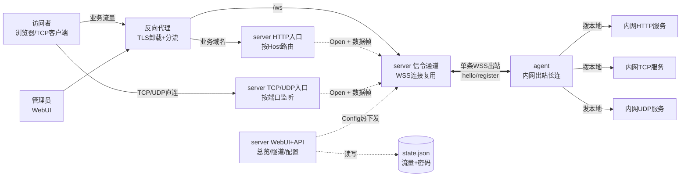
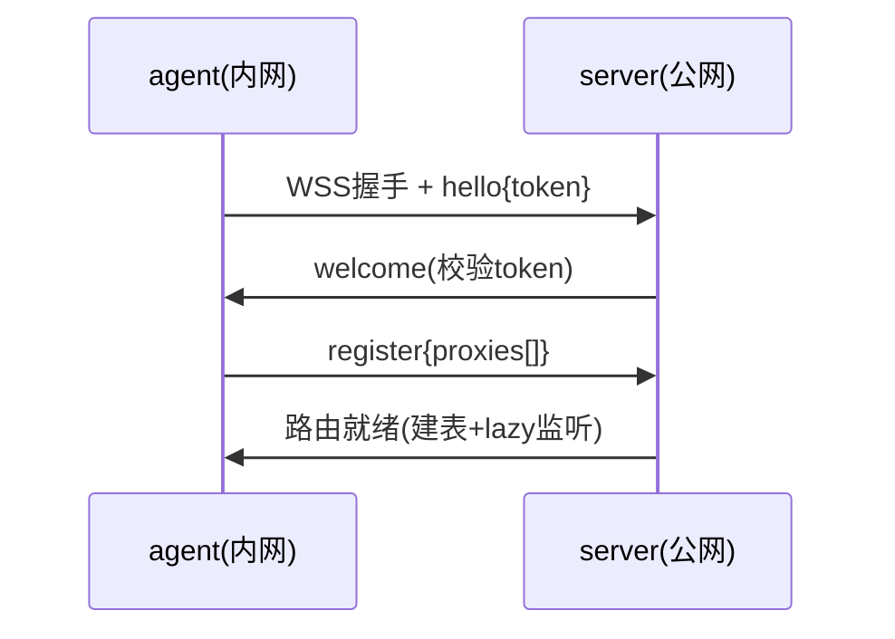
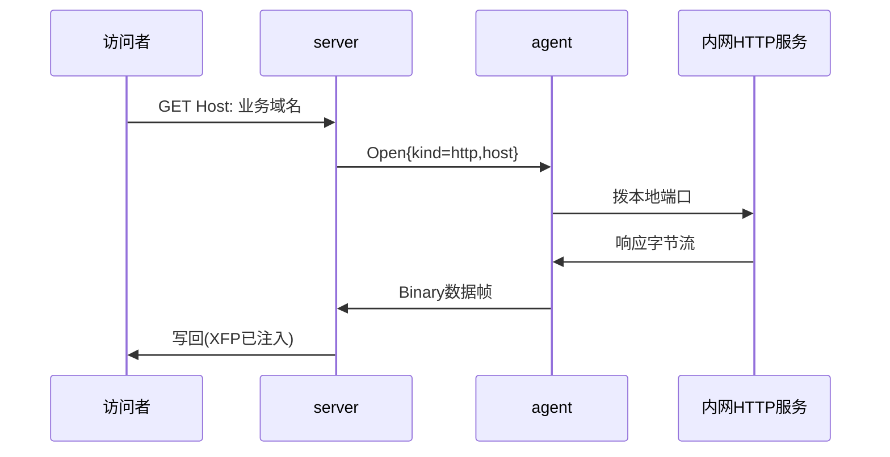
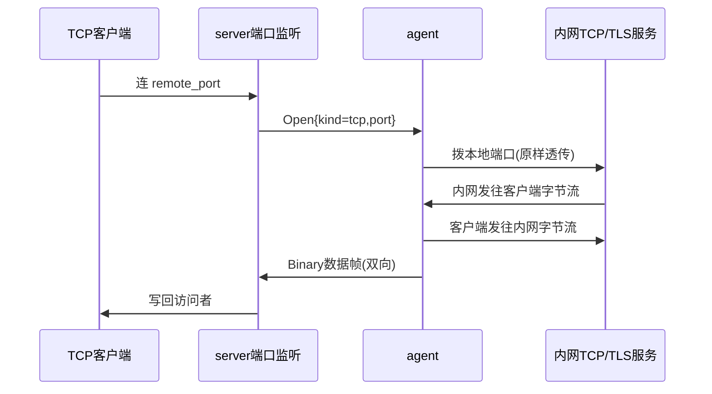
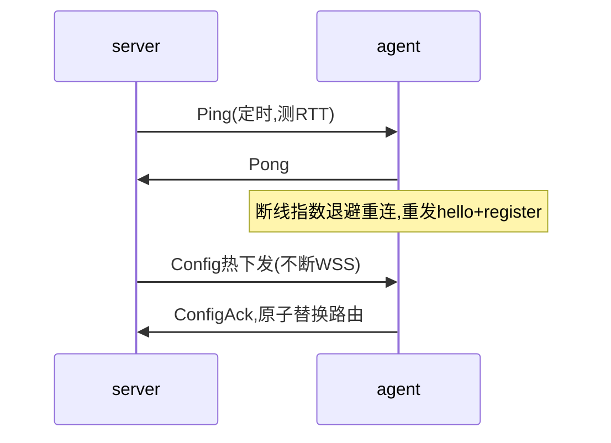

# neutrino 架构与典型流程

## 一句话：是 server/agent 模式吗？

**是，但方向反直觉**：不是 server 主动连内网，而是**内网 agent 单条 WSS 出站长连打到公网 server**，
所有隧道都复用这一条连接。公网进来的访问者流量，由 server 通过这条长连"反向"捎回内网。
所以内网主机不需要公网 IP、不开任何入站端口——这就是"隐身"的来源。

## 架构图

关键点：

- **控制帧**走 WSS Text JSON（`hello/register/ping/pong/open/close/config`），**数据帧**走 WSS Binary
  `[stream_id:u32 BE][payload]`，server 用偶数 id。TCP/HTTP 每连接一个 stream 全双工；
  UDP 每个 peer 一个 stream，每帧即一个 datagram。
- HTTP 按 `Host` 路由、可注入 `X-Forwarded-Proto`；TCP/UDP 按 `remote_port` 路由（lazy 监听）；
  HTTPS 当 TCP 透传、不解密。

## 典型场景

### 1. 建连注册（agent 上线，只出不进）

### 2. HTTP 穿透（最常用）

### 3. TCP/HTTPS 透传（TLS 不解密）

任一方向 EOF 即发 `Close` 收尾（`select` 非 `join`，避免两端互等死锁）。

### 4. 保活、断线重连、热更新

管理员在 WebUI `POST /api/config` 推送新隧道列表，在途 stream 继续 draining；
`POST /api/tunnels/:agent/:name/enabled` 即时启停单个隧道。
