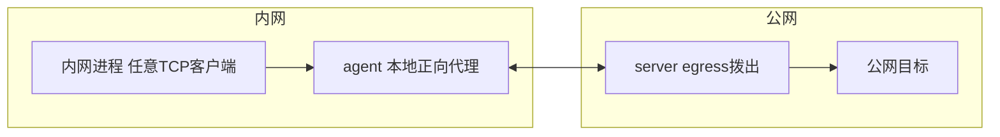
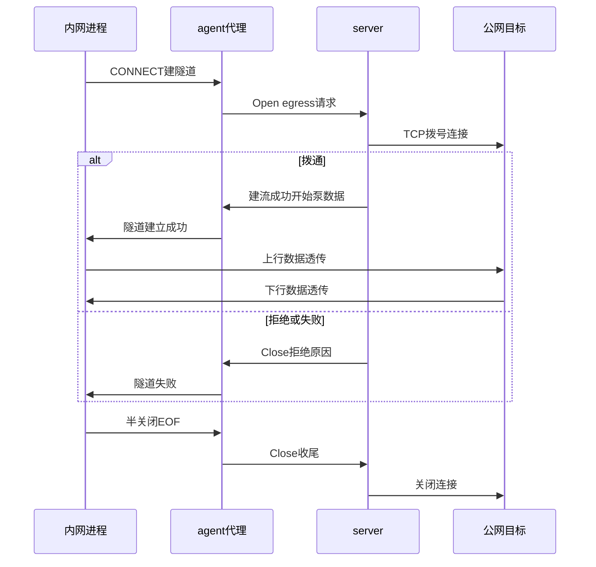

# neutrino egress（出网代理）设计

日期： 2026-10-19 ｜ 状态： 已实现（一期 HTTP，commit 076a3c9） ｜ 需求来源： 通用 TCP 出口（内网经 server 出口访问公网）

## 1. 背景与目标

- 现状：neutrino 只有 ingress（公网 → server → agent → 内网服务）。`ClientMsg::Open.kind` 预留了 agent-initiated 但未实现。
- 目标：通用 TCP 出口——内网进程经 agent 本地正向代理 → 复用现有 WSS 长连接 → server 主动拨公网，出口 IP = server 机器。
- 非目标：UDP ASSOCIATE 首期不做；peer 被动 incoming 端口不在本文。

## 2. 架构与数据流



- server 侧**不需要开新公网端口**：egress 是主动拨出（connect），不是 listen。DNS 也在 server 侧解析。
- 与 ingress 对称：ingress 是 `ServerMsg::Open` → agent 拨本地；egress 是 `ClientMsg::Open{egress}` → server 拨公网。stream 泵、sid 管理、心跳鉴权全部复用。

### UML 时序（egress 建流 / 数据 / 收尾）



## 3. 组件与接口

### 3.1 agent 侧（新增）

- 新增 `egress` 配置段（agent 本地生效，**不走 server desired**，因为这是 agent 本机的监听行为）。默认关闭，配置或本地 WebUI 打开：
  ```toml
  [egress.http]
  listen_ip = "0.0.0.0"     # 默认全绑，方便局域网共享；只本机用改 127.0.0.1
  listen_port = 18080
  enabled = false
  ```

- 首版只做 HTTP（见 docs/todo.md：SOCKS5 / mixed 列为二、三期）。
- HTTP forward proxy：CONNECT 建隧道；普通 HTTP（`GET http://host/path` 绝对 URI）解析目标 host:port 建 egress 流，原请求字节原样转发。
- SOCKS5：二期再做，本期不实现。
- agent 本地 WebUI 加“出网代理”页：总开关 enabled、listen_ip、listen_port 输入 + 运行状态（监听中/端口被占标红/未启用），保存后写本地配置并重启 egress 监听生效，不断 WSS 主链。

### 3.2 server 侧（默认支持）

- server 默认支持 egress，无需额外开端口、无需开启开关：收到 `ClientMsg::Open{kind:"egress"}` 即 `TcpStream::connect(host:port)`，拨号超时 30s，后接现有 pump。CONNECT 无端口默认 80；DNS 完全 server 侧解析。
- server WebUI：agent 行显示"egress 开/关"状态（只读，开关在 agent 侧）。访问控制（白名单/按 agent 授权）作为后续增强，首期不做门禁。
- **实现偏差（2026-10-19）**：server WebUI 只读状态未做——需扩展 Register 协议上报 egress 开关，延期到二期；一期 egress 状态只在 agent 本地 WebUI 可见。
  另两处实现级修复：① server 加 `pending` 早到缓存（Open 与首包背靠背乱序）+ 泵启动 drain；② eof 标记走 outbox 同通道空包保序（原 ctl Close{eof} 与数据通道 select 乱序致空 BODY，见 e2e 注释）。

### 3.3 协议变更

- `ClientMsg::Open.kind` 新增 `"egress"`（原来 `"http"|"tcp"` + 预留位，注释更新）。
- 其余帧格式不变（Open/Close/Data 复用）。`ServerMsg::Open` 不变。

## 4. 安全说明（首期默认放行，增强待定）

- 首期：server 默认放行 egress（与"server 默认支持"一致），不做目标白名单、不做按 agent 开关。
- 后续增强（需评审，另开 spec）：目标白名单（按 host:port 匹配才拨）、按 agent 授权（desired 里配 `allow_egress`）。
- 风险提示：任一 agent 沦陷即 server 出口被借用；大流量会吃 server 带宽（见 §6）。

## 5. 错误处理

- server 拨公网失败/超时 → 回 `Close{reason:"dial refused/timeout..."}`，agent 侧给本地客户端返回 CONNECT 失败 / SOCKS 拒绝，日志记一条。
- agent 本地监听端口被占 → agent 启动日志 warn + 本地 WebUI 标红，不影响 WSS 主链。
- WSS 断开 → 本地代理接受连接但直接失败（fail-fast），重连后自动恢复。

## 6. 流量提醒（非功能约束）

- 代理一开，所有经它的流量（小请求 + 大下载）都走 server 出口。server 若是小 VPS，大流量会吃带宽——建议只给需要的进程配代理，不做全局网关。
- 本设计不解决带宽问题，只给开关。

## 7. 测试

- 单元：HTTP 代理请求解析（普通 GET 绝对 URI / CONNECT 建隧道+目标解析）。
- e2e：agent 本地 HTTP 代理 → server 拨测试后端 → 回包；拨失败返回 Close；`curl -x http://127.0.0.1:18080` 模拟通用客户端。
- 现有测试全绿（协议加 kind 不破坏旧帧解析）。

## 8. 自检

- 与 ingress 对称，无新帧格式；agent 监听默认 0.0.0.0:18080（B 方案）。
- server 默认支持 egress；开关只在 agent 侧（配置 + 本地 WebUI）。
