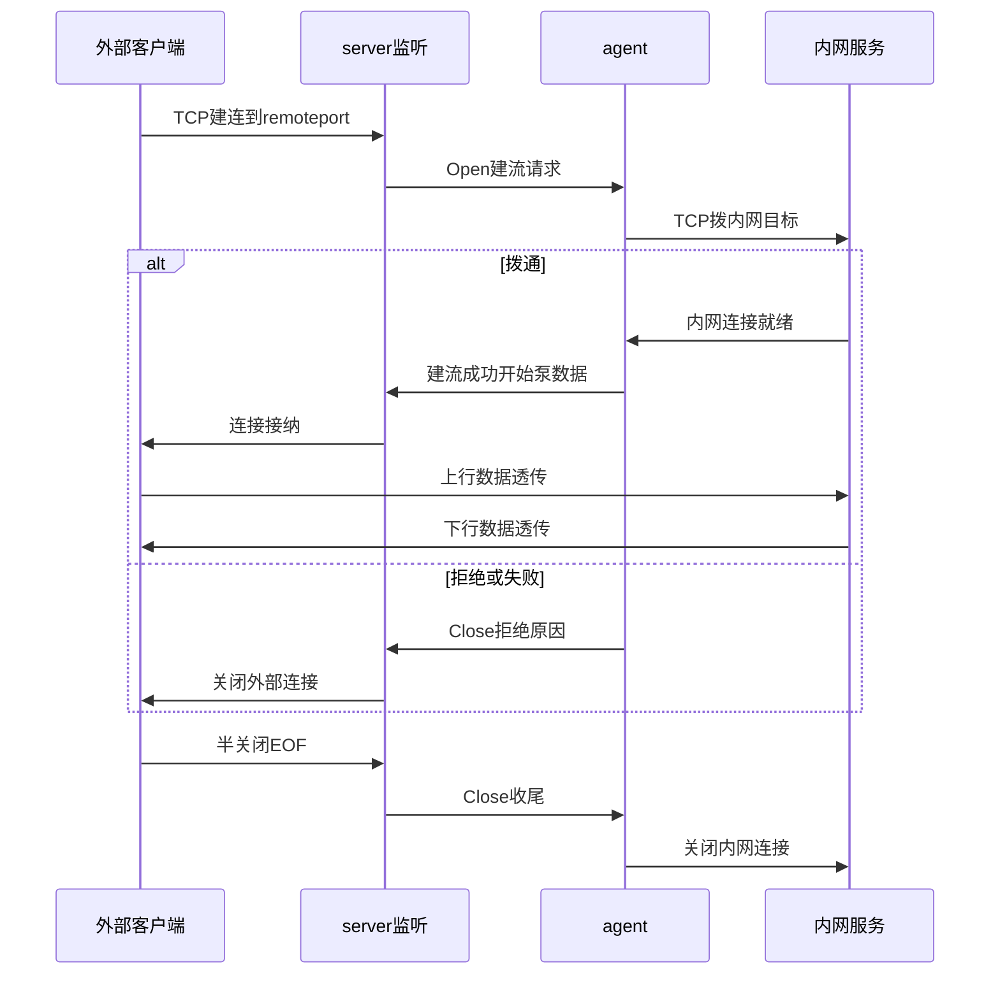
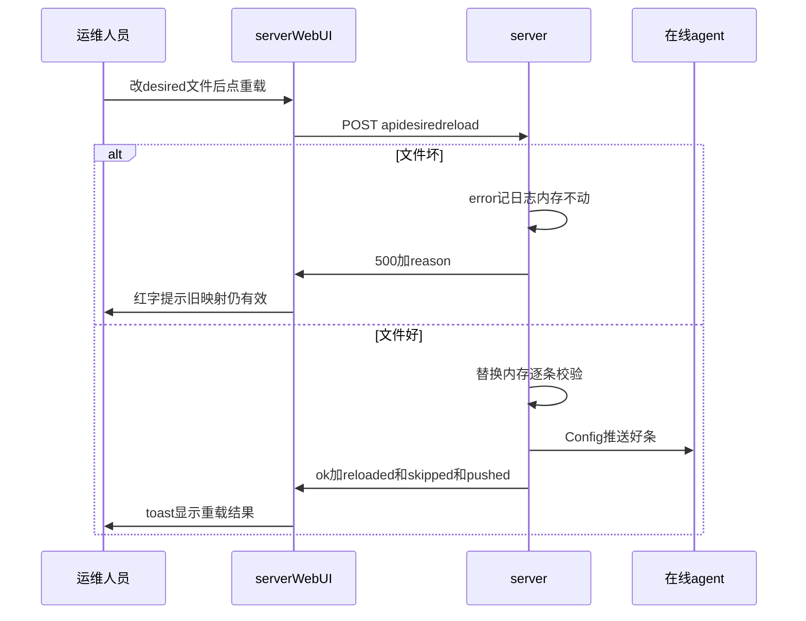

# neutrino 公网端口 ingress（通用端口映射）设计

日期： 2026-10-19 ｜ 状态： 映射已实现，§6 重载按钮待实现 ｜ 需求来源： 内网端口经 server 出口对外提供服务

## 1. 背景与目标

- 目标：把 agent 内网里的一个 TCP/UDP 端口，映射到 server 网络里对外提供服务。外部客户端访问 `server 公网地址:remote_port`，流量经隧道落地到内网 `local_ip:local_port`。
- 结论先行：**映射本身代码侧现成，零开发**；本篇 §2–§5 是通用做法说明，§6 是待实现的生效方式补齐。
- 与 egress（出网代理）正交：一个管进（server listen → agent 拨内网），一个管出（agent listen → server 拨公网），复用同一套 stream 泵。

### 流量拓扑


- 外部客户端只感知 `server公网地址:remote_port`；隧道内走 WSS 长连的 stream 泵；agent 再拨一次内网目标。

## 2. 做法（纯配置）

### 2.1 server desired（`tunnel/data/desired.toml`，唯一来源）

```toml
[[agents.<hostname>]]
name = "svc-tcp"
type = "tcp"
local_ip = "172.28.0.10"
local_port = 51413
remote_port = 51413
enabled = true

[[agents.<hostname>]]
name = "svc-udp"
type = "udp"
local_ip = "172.28.0.10"
local_port = 51413
remote_port = 51413
enabled = true
```

- 字段含义：`type` 取 `tcp`/`udp`；`remote_port` 是 server 侧监听的公网端口；`local_ip:local_port` 是 agent 侧要拨的内网目标；`enabled` 控制开关。
- `local_port` 与 `remote_port` 可以不同（如内网 8080 对外 9000），按需填写。
- TCP/UDP 各配一段；只需要 TCP 时只配 `type="tcp"` 那段即可。

### 2.2 生效机制（代码现状）

- server 启动/热加载后，对每个 `enabled` 且 `remote_port > 0` 的条目自动 `bind 0.0.0.0:remote_port`（见 `src/server.rs::ensure_tcp_listener` / `ensure_udp_listener`）。
- 外部连接进来 → 按 `remote_port` 选 agent → agent 拨内网 `local_ip:local_port`，双向透传。
- TCP 是纯字节透传，无应用层语义干扰；UDP 按 peer session 转发。
- 回滚：desired 里对应条目 `enabled = false`，秒级摘除。

### UML 时序（外部建连 / 数据 / 收尾）



## 3. 前置条件（基础设施层面，与代码无关）

- server 必须能在公网 `listen` 到 `remote_port`：若 server 跑在 NAT/面板之后，需要在上游加 `remote_port → server 内网` 的端口映射，否则公网流量到不了 server，配了也不通。
- 不满足时：先补映射，再按 §2 配置；不要改代码，改了也没用。

## 4. 灰度建议

- 先加 TCP 验证连通性，再加 UDP（或反之），分步确认。
- 关注 server 出口带宽：大流量服务经 server 中转，中转带宽可能成为瓶颈，先灰度观察再全切。

## 5. 测试

- TCP：外部 `nc -v <server公网地址> <remote_port>` 能连上，业务握手正常。
- UDP：`nc -u` 探活 + 实际业务有来回包即算过。
- 回归（已有，无需新写）：`tests/e2e.rs::e2e_tcp_passthrough`（TCP 回声）、`e2e_udp_and_hot_config`（UDP 回声 + 热配摘路由）。

## 6. 配置生效方式：要么重启，要么点按钮（待实现）

- 现状不对称：WebUI 改（`POST /api/desired/:hostname`）即时生效；**手改文件只在 server 启动时加载一次**，改完要么重启，要么进 WebUI 随便保存一次间接触发。
- 决策：**要么重启生效，要么点按钮**。不做文件监听（无新依赖、无跨平台事件坑），不做门禁/审批（超出范围）。

### 6.1 后端：`POST /api/desired/reload`

- 路由：`src/server.rs` 加 `.route("/api/desired/reload", post(api_desired_reload))`，注意 Axum 路由优先级——`/api/desired/reload` 必须先于 `/api/desired/:hostname` 注册（或确认 Axum 静态段优先，单测覆盖）。
- 行为：
  1. `DesiredStore::load(&s.desired_path)` 重读文件，全量替换内存 `s.desired`。
  2. 对在线 agent 按 hostname 推 `ServerMsg::Config` + 调 `apply_proxies_for_agent`（复用 `api_desired_set` 后半段，不落盘——文件本身就是源）。
  3. 返回 `{ok, reloaded, skipped, pushed}`。
- 出错进日志（核心诉求）：
  - 文件读不到 / TOML 解析失败 → `error!`（含 path），接口返回 500 + reason，内存保持不动。
  - 解析成功但某条 `validate_proxy` 不过 → 逐条 `warn!`（含 hostname/name/原因），**跳过坏条、好条照常生效**，`skipped` 计数返回。
  - 现状 `DesiredStore::load` 解析失败静默 `unwrap_or_default()`，本次顺手让 load 侧也打 warn（保持行为兼容，只加日志）。
- 鉴权：沿用现有 `auth_ok` + JWT，与其它 `/api/*` 一致。

### UML 时序（重载生效 / 出错）



### 6.2 前端：server WebUI「从文件重载」按钮

- 文件：`web/index.html`，期望态编辑区按钮排（`loadDesired`/`saveForm` 处）新增「从文件重载」按钮，样式 `.btn ghost`。
- JS：`fetch('/api/desired/reload', {method:'POST', headers:hdrs(true)})` → toast 显示 `已重载 N 条，跳过 M 条，推送 K 个 agent`；失败 toast 红字显示 reason。沿用现有 `toast(m,err)`，无新风格。

### 6.3 测试

- 单测（`src/server.rs::tests`）：路由优先级——`POST /api/desired/reload` 不被 `:hostname` 吞掉（`reload` 当 hostname 查应无此行为）。
- e2e（`tests/e2e.rs`）：手改 desired 文件加一条 tcp 映射 → 调 reload → 端口通；再把文件改错（非法 TOML）→ 调 reload 返回 500 且旧映射仍通（内存不动）；修好文件但某条字段非法 → reload 成功、好条生效、坏条跳过（看返回 `skipped=1`）。
- 全绿门槛：`make build` 零 warning + `make test`（44+9 及新增）。

## 7. 非目标

- 文件监听/自动热加载（notify/mtime 轮询都不做）。
- 门禁、审批、白名单、按 agent 授权（另开需求）。
- server WebUI agent 行 egress 只读状态（egress 二期，已在 todo）。

## 8. 自检

- 无代码变更（§6 除外），无 TBD；前置条件明确（上游端口映射），不满足则配了也不通。
- §6 范围单计划可装下：server.rs 一接口 + index.html 一按钮 + 单测一则 + e2e 一则；路由优先级、坏条跳过语义、内存不动保证均已明确，无双解。
- 后续增强（另开需求，不在本篇）：按 agent 授权、按端口白名单。
