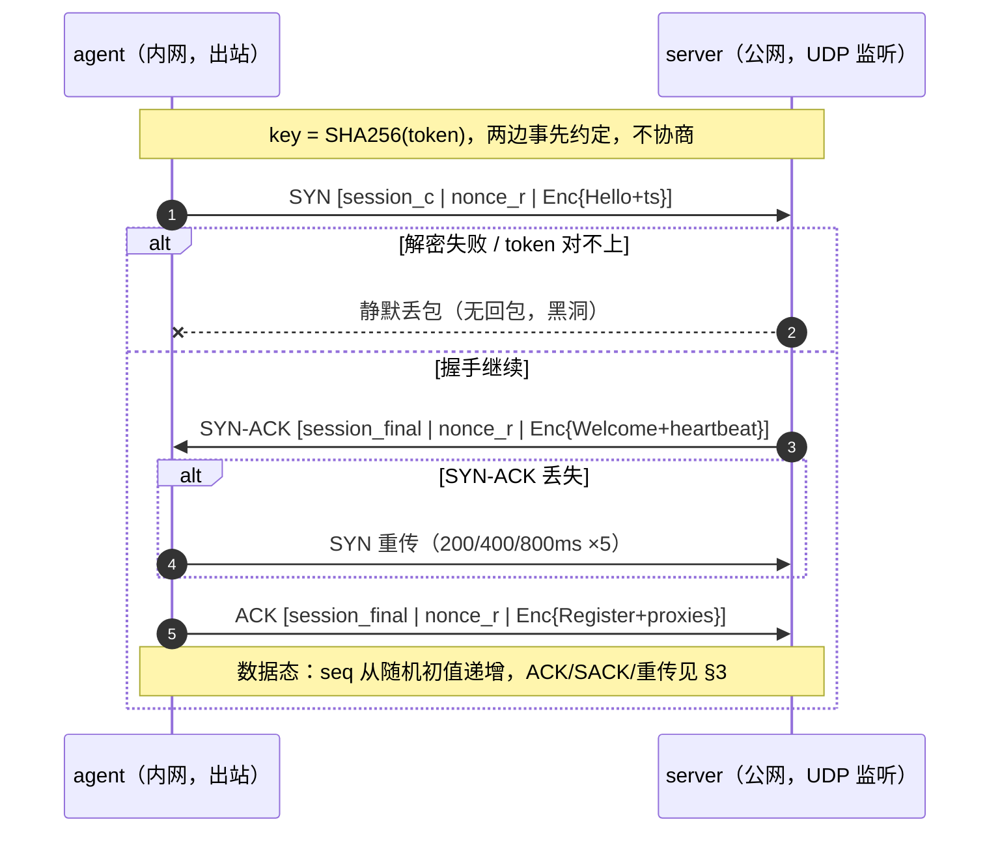
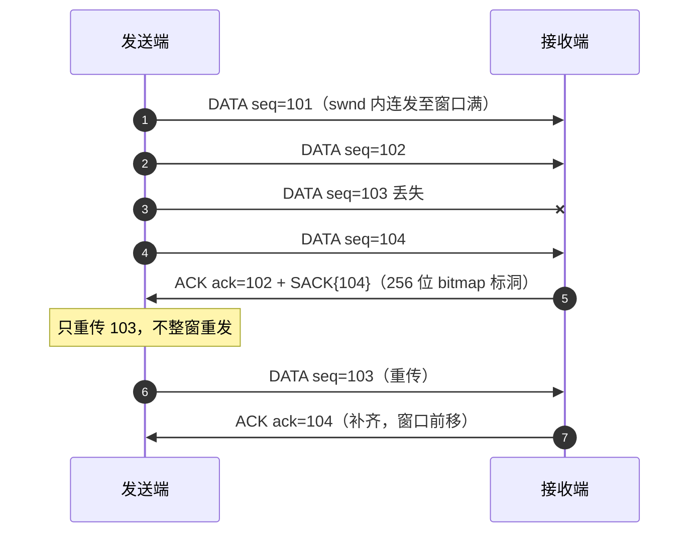
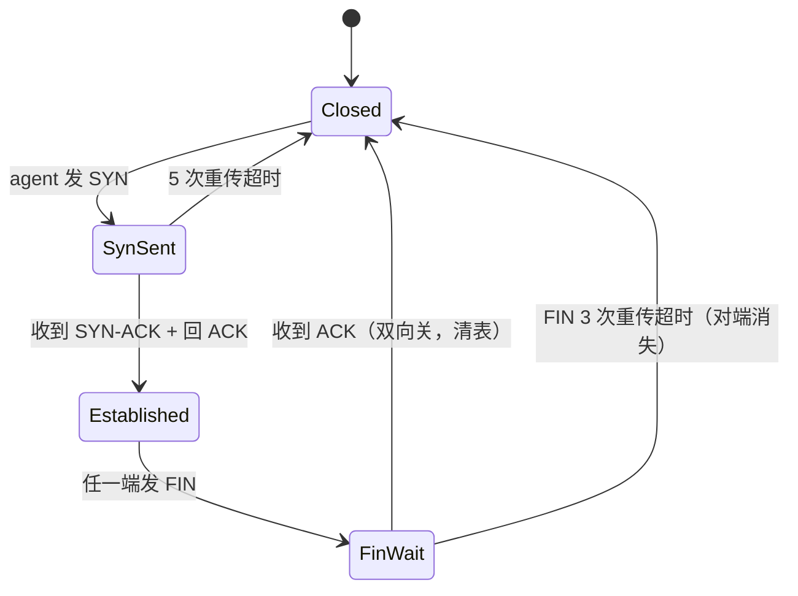
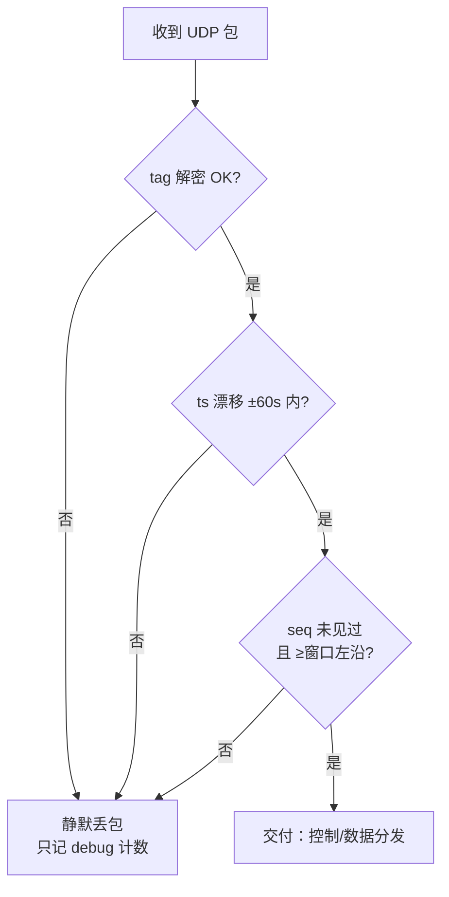
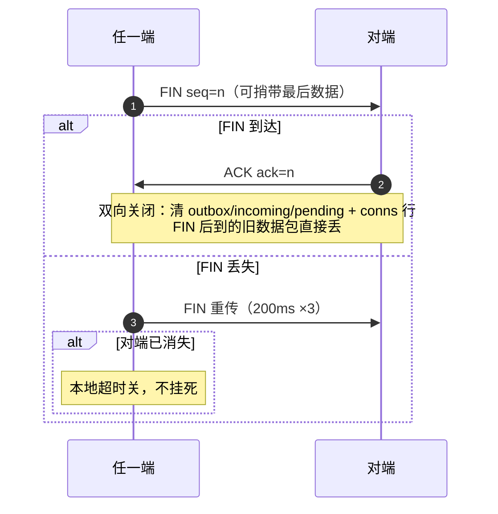
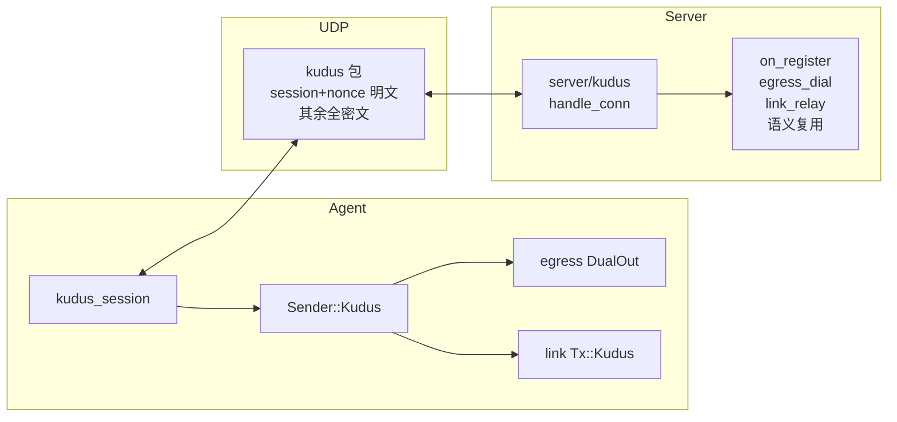

# kudus 传输设计（自研 UDP 可靠传输 + 全随机隐身）

- 状态：brainstorm 确认（1–7 OK，全随机版）
- 日期：2026-10-21
- 动机：躲 QUIC/TLS 指纹，裸 UDP + 自研帧，线上无特征
- 密钥：两边 token 事先约定，`key = SHA256(token)`，无协商、无证书、无 TLS

## 1. 包格式（全随机版）

UDP datagram = 1 包，不分片。超 1232B 上层不发（控制大帧走分片重组另议，v1 超了记错不断链）。

```
| session_id 4B 明文 | nonce 24B 随机 | ciphertext (XChaCha20-Poly1305, key=SHA256(token)) |
明文解密后 = [ ver 1B | flags 1B | seq 4B | ack 4B | sack_bits 32B | ts_ms 8B | proto_frame ... ] + 16B tag
```

- `session_id`：握手定，4B 随机，FIN/120s 无包即焚，永不复用。多路标识 + 选 key 上下文（server 挂 N 个 agent）。
- `nonce`：每包 24B 纯随机，XChaCha nonce。无递增、无魔数、无固定长度头。
- `seq/ack/sack`：全在密文里。ACK 引用 seq 靠内存 `nonce→seq` 映射（命中即删，最多挂窗口 64 条），查不到即丢——天然抗重放。
- `proto_frame`：复用现有语义（控制 JSON / `[sid:u32][payload]` / dgram 内帧），不重新发明。
- 可用载荷预算：1232 − 4 − 24 − 48 − 16 ≈ 1140B。

## 2. 密钥与握手（两轮，token 错全程静默黑洞）

- 密钥：`key = SHA256(token)`，预共享，包里不传任何密钥材料。
- C→S `SYN`：随机 `session_c`，密文内 `Hello{token,hostname} + ts`。
- S→C `SYN-ACK`：回 `session_final = session_c ^ rand_s`，密文内 `Welcome{heartbeat}`。
- C→S `ACK`：密文内 `Register{proxies}`，进入数据态。
- 任一步解密失败 / Hello.token 对不上 → **静默丢包，不回包**（扫描器看到黑洞，无 oracle）。
- 重传：SYN/SYN-ACK 丢了 200ms/400ms/800ms 重发，最多 5 次；超时按 token 错同等处理（只记 debug）。



## 3. 可靠传输（滑动窗口 + SACK + 简版 AIMD）



- 每个方向独立 `seq`（u32，SYN 后随机初值递增 = Packet Number）。
- 发送窗口 `swnd = min(cwnd, 对端 rwnd)`；v1 `rwnd` 恒 64 包（字段预留，v2 动态），`cwnd` 初值 16。
- ACK：收到数据包即回 `ack=最高连续seq + 256 位 SACK bitmap`。
- RTT：包内 `ts_ms` 回显测量，`RTO = max(200ms, 2×SRTT)`，超时只重传未确认包。
- 拥塞（简版 AIMD）：超时丢包 → `cwnd=max(4, cwnd/2)`；每 RTT 无丢包 → `cwnd+=1`。无慢启动/BBR，v2 再调。
- 状态机：



## 4. 重放/播放防护（命中即丢，不回包）



- 每 `session_id` 维护 `last_ts + 已见 seq 窗口`；三判任一命中即丢，不回包、不记 warn（防扫描器拿日志当 oracle）。
- `nonce→seq` 映射查不到的 ACK 同样丢。

## 5. 断开（两步快关，无半关闭）



## 6. 与现有架构集成（语义层零改动）

- `common/kudus.rs`：成帧/加解密/SACK bitmap 纯函数 + 单测；`Transport` 加 `Kudus{host,port}`，`parse_server_url` 加 `kudus://` 分支。
- `server/kudus.rs`：`run_kudus(shared, token, bind)` + `handle_conn`，握手后复用 `on_register / spawn_egress_dial / spawn_link_relay`，只换发包器。
- `agent/kudus_session.rs`：dial→握手→Register→心跳→Config 热更新→分发；egress/link 的 `Sender/DualOut/Tx` 加 `Kudus` 变体。
- CLI：`server --kudus-listen`（空=不开）+ `agent --server kudus://host:port`，与 `--quic-listen` 对称。



## 7. 测试

- 单测（纯函数）：加解密 roundtrip、tag 错丢包、SACK 补洞、RTO 重传、重放丢弃、FIN 快关。
- e2e：照 `boot_quic` 抄 `boot_kudus`（http/udp/热配/错 token 黑洞——错 token 时 agents 表无残留且 server 零回包）。
