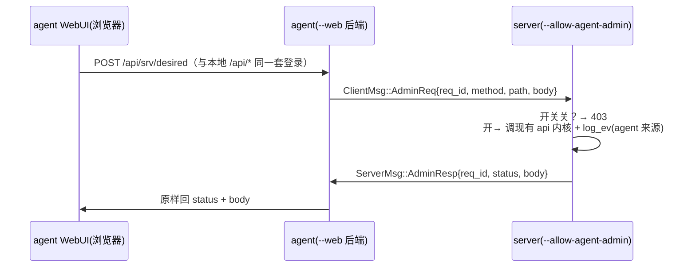

# agent 管理 server（agent-admin）设计

日期：2026-10-22 · 状态：brainstorming 已确认。

## 1. 背景与目标

agent 本地 WebUI（`--web`）现在只能看自己、改上行；server 全套管理页（`web/index.html`）
只能在 server 本机/公网端口看。出差在外想管 hk server，得先 ssh 回家。
目标：agent 页长出 server 管理页的完整读写能力（tunnels CRUD、desired 编辑、限速、
日志、流量统计、改口令），经 agent 已认证隧道转手，浏览器只和 agent 说话。

## 2. 信任模型（B：token 即最高权 + server 开关）

- server 启动开关 `--allow-agent-admin`（默认**关**）。没开：任何 `AdminReq` 直接回
  `Error{reason="agent admin disabled"}`，读也不给。
- 开了 = **无条件信任所有持 token 连上来的 agent 可读写全 server**。
  后果：token 从"建隧道凭证"升级为"全 server 管理权"；任一 agent 机器沦陷 = hk 全沦陷。
  写进本节，部署时必须换强 token（默认 `welcome2neutrino` 的机器可直接管 hk）。
- 补偿（必做，不拦只喊+记账）：
  1. server 启动时 token 弱（长度 < 16）打 warn 日志。
  2. 每次写请求 `log_ev("agent '<hostname>' admin <op> <detail>")`，出事可溯源。

## 3. 协议（`common/proto.rs`，三传输共享）

```rust
// ClientMsg 新增：
AdminReq { req_id: u64, method: String, path: String, body: String },
// ServerMsg 新增：
AdminResp { req_id: u64, status: u16, body: String },
```

- `path` 复用 server 现有 `/api/*` 口径（如 `overview`、`tunnels`、`desired`、`logs`…），
  `body` 是 JSON 字符串（透传，不解析）。
- agent 发 `AdminReq` 后等 `req_id` 对应的 `AdminResp`（本地 oneshot map，超时 15s）。
- server 收到 `AdminReq`：先看开关（关→`AdminResp{status:403, body="agent admin disabled"}`），
  开→调**现有** api handler 内核（与 HTTP 层同函数，只换输入输出外壳）→ `AdminResp`。
  读（`overview`/`tunnels`/`logs`/流量）写（`desired`/`toggle`/改口令）一视同仁。
- 三传输都要做：WSS（`agent/session.rs` + `server/tunnel.rs`）、QUIC（双端 quic_session/server quic）、
  kudus（双端 kudus_session/server kudus）。分支逻辑同构复制三份。

## 4. 数据流



## 5. agent 前端（`web/agent.html`，方案 B：重写不嵌 iframe）

- 新增"server 管理" tab，复制 `web/index.html` 的管理逻辑，请求前缀 `/api/`→`/api/srv/`。
- server 以后加字段/接口，agent 页手动跟（双份维护，接受）。
- 登录：agent 本地口令管整页（含 server tab），不再二次登录（信任模型 B 的含义）。

## 6. 测试（只要单测，e2e 不跑）

- `AdminReq/AdminResp` serde roundtrip。
- server 开关关→403 纯函数（判定抽纯函数，可单测）。
- agent 侧 req_id↔oneshot 注册/超时清理单测。
- api 内核复用：被转手调用的 handler 输入输出与 HTTP 层一致（单测调内核）。
- 验证：`make build` 零 warning + `cargo test --bin neutrino` 全绿。

## 7. 不做

- 细粒度鉴权（只能管自己隧道等）：开了就是全权，不开就是没有。
- 透传用户凭证/独立管理 token（B 模型下不需要）。
- e2e（用户明确不要）。
- 重连错峰、毫秒 RTT（kudus 心跳 spec 的不做项，仍不做）。
