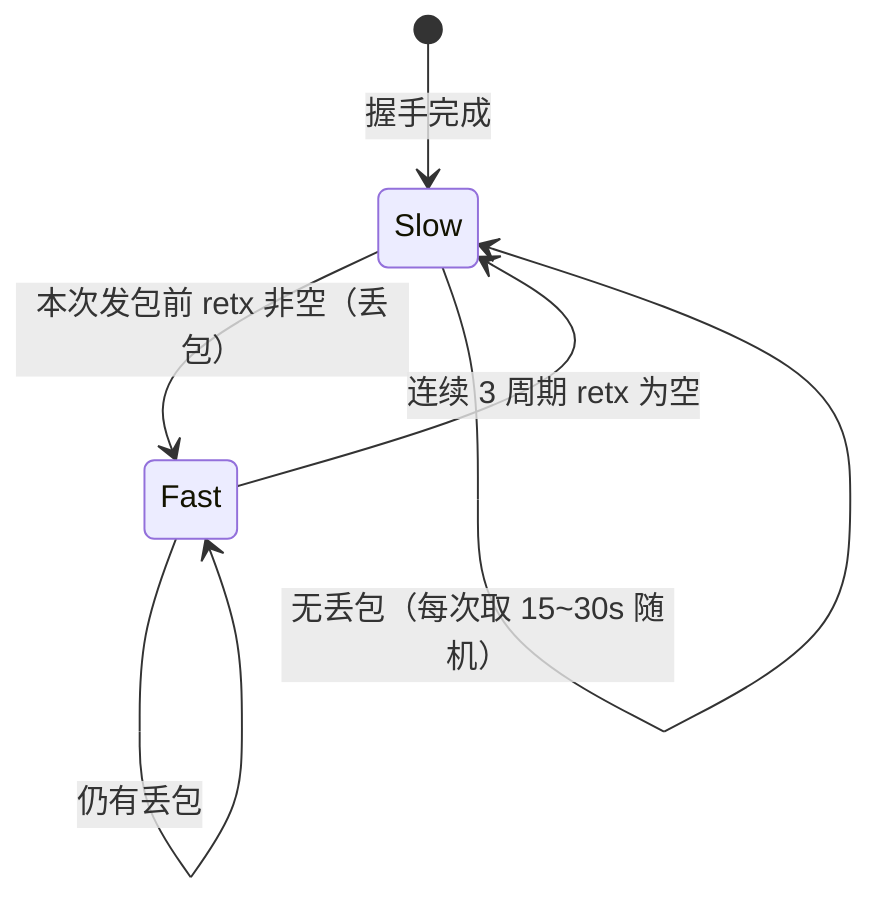

# kudus 心跳重整设计（jitter + 自适应 + 双向看门狗）

日期：2026-10-22 · 状态：brainstorming 已确认（只动 kudus，WSS/QUIC 不动）。

## 1. 背景与目标

- 现状：agent→server 固定 30s Ping；server→agent 固定 15s Ping；kudus 双端读循环裸等、无超时。
- 现场问题：
  1. 固定间隔多 agent 对齐 → 惊群（同时打点）。
  2. server OOM 重启后 agent 无感知（macmini 2026-10-21 卡旧会话，0.7.1）。
  3. agent 断网后 server 侧僵尸会话永久占路由，只能等新 Hello 顶掉。
  4. server→agent Ping 唯一作用是量 server 视角 RTT，无保活语义。
- 目标：jitter 防对齐、丢包时加密自适应、双端 75s 看门狗、砍反向 Ping（server RTT 改由 agent 上报）。

## 2. 范围（只改 kudus）

- 改：`src/common/kudus.rs`（新 `Heartbeat` + `KUDUS_IDLE_KICK_SECS`）、
  `src/agent/kudus_session.rs`（ping loop + 主循环看门狗）、
  `src/server/kudus.rs`（删反向 Ping + RTT 上报 + 读循环看门狗）。
- 不动：WSS（`tunnel.rs`/`session.rs`，45s `IDLE_KICK_SECS` 不变）、QUIC 双端、
  `ClientMsg::Ping/Pong` 协议字段（毫秒精度不加，秒级够展示）。

## 3. 心跳间隔（Heartbeat helper，自适应 + jitter）

```rust
// common/kudus.rs
pub const KUDUS_IDLE_KICK_SECS: i64 = 75; // 容忍连丢 2 包（最坏 30s 间隔 + 1 次丢包不误踢）
pub struct Heartbeat { slow_min: u64, slow_max: u64, fast_min: u64, fast_max: u64, calm_need: u8, calm_hit: u8 }
impl Heartbeat {
    pub fn new() -> Self; // 15~30s 慢档 / 5~8s 快档 / 回慢档需 3 连好
    pub fn next_interval(&mut self, lossy: bool) -> Duration; // 纯函数，可单测
}
```

- 好链路：每次 15~30s 随机（防对齐 + NAT 保活）。
- 丢包（`lossy = rel.retx.len() > 0`，两端现成结构）：进快档 5~8s 随机。
- 迟滞：进快档 1 次即切，回慢档需连续 3 个周期无丢包（防翻转）。
- 看门狗不进 helper：就是一行 `timeout(KUDUS_IDLE_KICK_SECS)`，抽了反而绕。

## 4. 反向 Ping 砍掉 + RTT 上报

- server：删 Ping task + `last_ping`；`ClientMsg::Ping{ts}` 分支直接
  `rtt_ms = (now_unix - ts).max(0) * 1000`（秒级）；删 `ClientMsg::Pong` 分支。
- agent：`ServerMsg::Ping → 回 Pong` 分支**保留**（兼容旧 server，几行代码）。
- agent 自己的 RTT（`Pong{ts}` 回来算）不变。

## 5. 双向看门狗（同 75s）

```mermaid
sequenceDiagram
    participant A as agent(kudus)
    participant S as server(kudus)
    Note over A,S: 稳态：A 按 Heartbeat 发 Ping；S 只回 Pong（不再主动 Ping）
    A->>S: Ping{ts}（任何业务帧都算活）
    S->>A: Pong{ts}
    rect rgb(80, 20, 20)
    Note over S: S 75s 无任何帧 → cleanup + log + FIN 200ms×3 → 会话删
    Note over A: A 75s 无任何帧 → bail → 外层 backoff(1/2/5/10/30/60s)重连
    end
    Note over A,S: 谁先超时谁先动；另一端随后也超时，最终双端收敛
```



- server 超时：`log_ev(heartbeat timeout, kicking...)` + 现有 `cleanup`
 （清 agents/outbox/路由）+ FIN 200ms×3 尽力通知（UDP 可能丢，agent 看门狗兜底）。
- agent 超时：`bail!("kudus heartbeat timeout...")`，外层 backoff 重连不动。
- 看门狗从握手完成（Register 后）开始计时，Welcome 15s 等待不计入。



## 6. 测试

- 单测（纯函数，先红后绿）：
  1. `Heartbeat::next_interval`：慢档 ∈ [15,30]s；丢 1 包即进快档 ∈ [5,8]s；
     抖一次（好-坏-好）不回慢档，3 连好才回。
  2. kudus 版 idle 判定：`stale(0,76)=true, stale(0,75)=false`。
     （WSS 的 `is_idle_stale`+45s 不动，kudus 新函数或参数化，实现时定。）
- e2e：看门狗不等 75s（太慢）——靠单测锁语义；另加一条"kudus agent 上下线后 server 会话消失"
  验证 cleanup 路径（shutdown 即 channel 关闭，本来就有）。
- 验证：`make build` 零 warning + `make test` 全绿。

## 7. 不做

- WSS/QUIC 心跳不动（以后想迁再把 helper 搬过去）。
- 毫秒 RTT（协议字段不动）。
- 自适应调参（初版固定 15~30 / 5~8 / 3 连好，跑起来再看数）。
